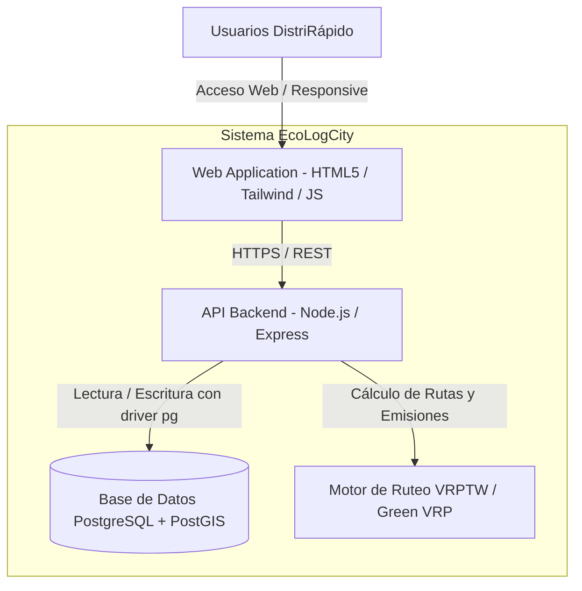
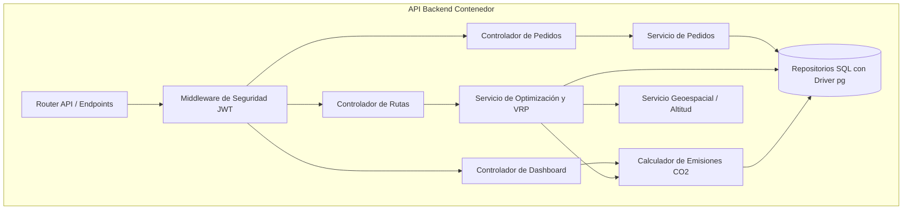

# Documento 07: Arquitectura de Software - Modelo C4

## Nivel 1: Diagrama de Contexto

El diagrama de contexto ilustra cómo los usuarios interactúan con EcoLogCity y cómo este se integra con los sistemas de terceros para cumplir su objetivo.

```mermaid
graph TD
    UserAdmin[Administrador/Operador Logístico] -->|Ingresa pedidos y planifica rutas| System[Sistema EcoLogCity]
    UserDriver[Conductor] -->|Visualiza rutas y actualiza entregas| System
    System -->|Carga de mapas base y geocodificación| OSM[OpenStreetMap / Nominatim API]
    System -->|Ruteo y distancias viales reales| OSRM[OSRM API (Open Source Routing Machine)]
    System -->|Envía notificaciones de ETA| Mail[Servidor SMTP / Correo Cliente]
```

## Nivel 2: Diagrama de Contenedores

Este diagrama detalla los contenedores principales de la plataforma web.



## Nivel 3: Diagrama de Componentes

Detalle interno del contenedor principal (API Backend), mostrando la segregación de responsabilidades.


